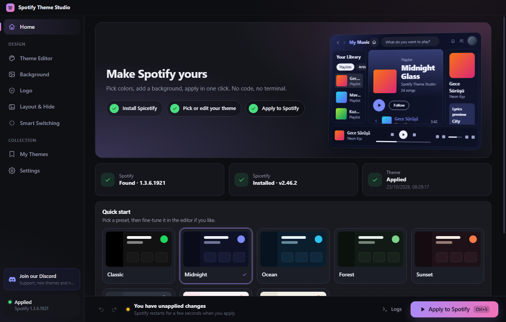
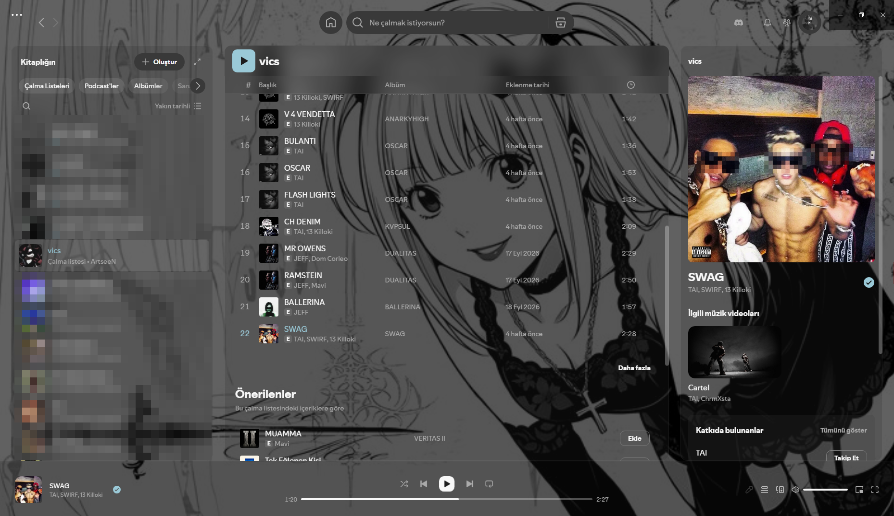
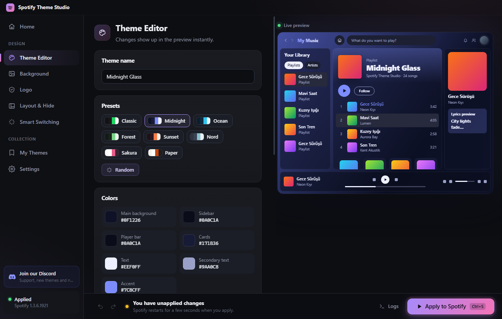
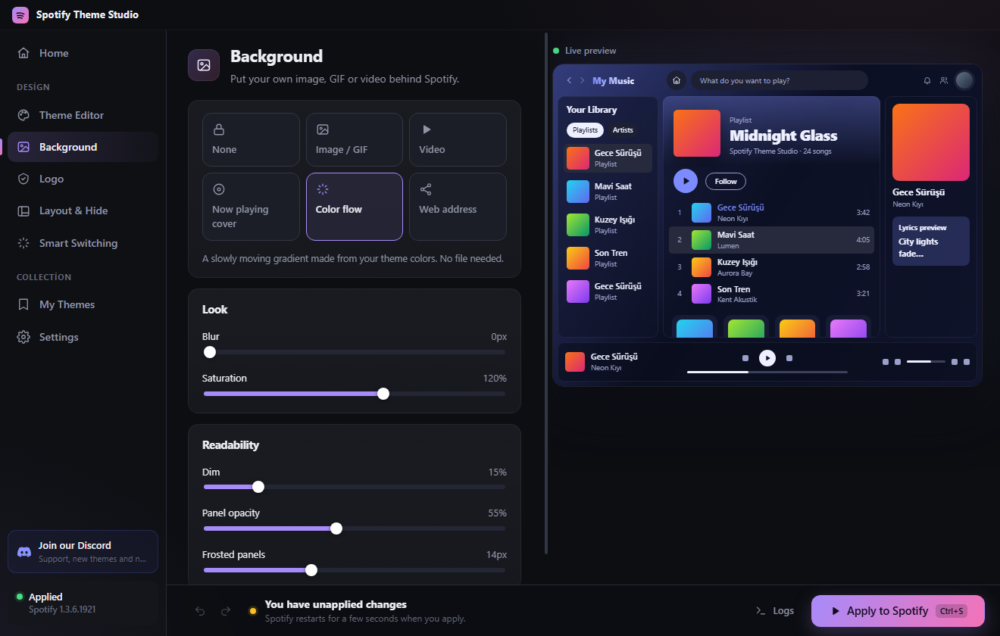
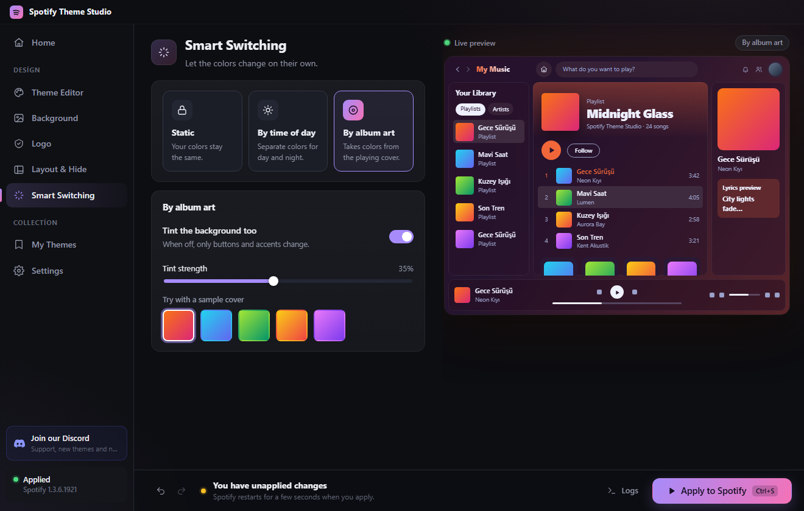
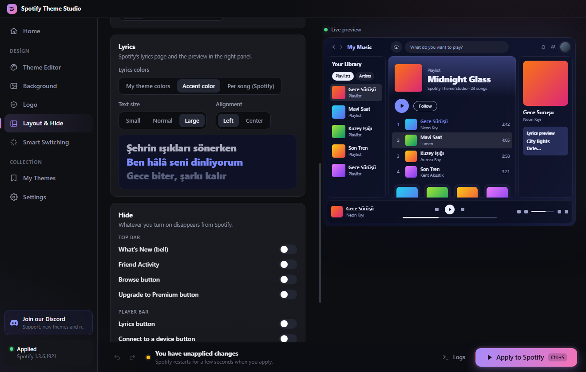
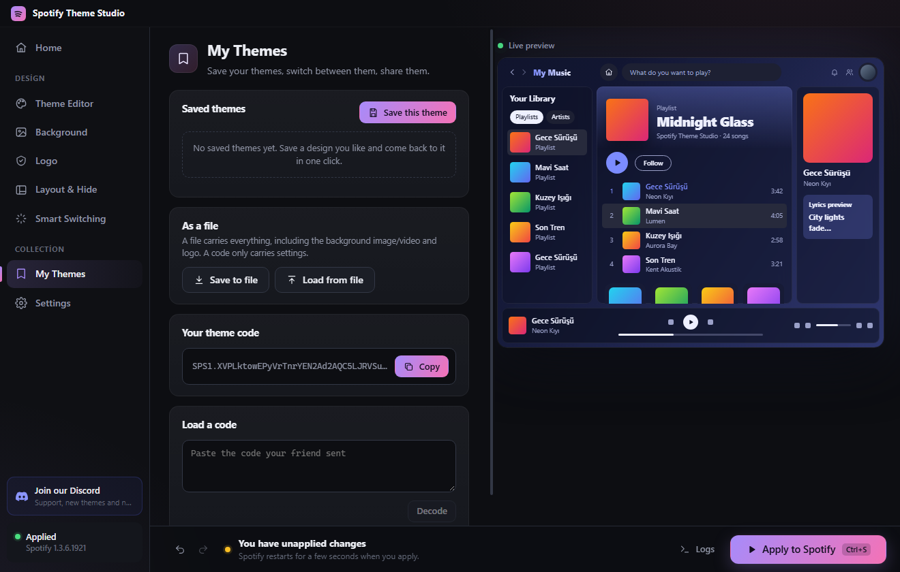

<div align="center">


# Spotify Theme Studio

**Customize the Spotify desktop app without writing a single line of code.**

Pick colors, drop in a background image or video, add your own logo, hide the buttons you never use, and apply it all with one click.

**English** · [Türkçe](README.tr.md) · [Join our Discord](https://discord.gg/ZKtPU5BHuN)



</div>

---

## What is it?

Spotify Theme Studio is a Windows app that turns the Spotify desktop client into something that looks the way *you* want. Under the hood it uses [Spicetify](https://spicetify.app), the community tool for modding Spotify. Spicetify itself is powerful but command-line only. Theme Studio wraps it in a visual editor with a live preview, so you never have to touch a terminal, a CSS file or a config file.

It installs Spicetify for you, backs up Spotify before changing anything, re-applies your theme after Spotify updates, and can put Spotify back to stock with one button.

### In Spotify

A custom background image behind see-through panels, a frosted sticky header, an accent-colored play button and the Discord button in the top bar:



## Features

### 🎨 Theme editor
- 8 built-in presets (Classic, Midnight, Ocean, Forest, Sunset, Nord, Sakura, Paper) plus a **random palette** button
- Edit 7 base colors, or fine-tune all 18 Spotify colors individually
- Fonts (system and Google Fonts), corner radius and button shape
- Every change shows up instantly in a **live Spotify preview**



### 🖼️ Backgrounds
- Your own **image, GIF or video**, a web address, the **cover of the song that is playing**, or an animated **color flow** made from your theme
- Position, size, blur, saturation and dim controls
- See-through, frosted-glass panels with adjustable opacity
- **Generate a color palette from your background image** in one click



### ✨ Smart switching
- **By time of day:** separate day and night palettes that switch automatically
- **By album art:** accent and background colors follow the cover of the song that is playing



### 🧩 Layout, lyrics and hiding things
- Gap between panels, floating player bar, scrollbar style
- Hover animations, text shadow, black-and-white or zooming covers
- **Lyrics** in your theme colors or accent color, three sizes, left or centered
- Page headers in your theme color instead of a different color on every page
- Hide 9 elements: What's New bell, Friend Activity, Browse, Upgrade to Premium, lyrics, connect, miniplayer and full-screen buttons, and the lyrics preview



### 🏷️ Your own logo
Put an image or your name (rendered as a gradient in your accent color) in Spotify's top bar, or replace the Home button icon.

### 💾 My Themes and sharing
- Save as many themes as you like and switch between them in one click
- Share a theme as a short **code** (`SPS1.…`) that a friend can paste in
- Or export a **`.spstudio` file** that also carries your background and logo
- Imported codes and files are validated, so a shared theme can't inject anything harmful into Spotify



### ⚡ Quality of life
- **One-click setup:** downloads and installs the latest Spicetify for you
- **Auto re-apply:** Spotify wipes mods on every update; Theme Studio notices and brings your theme back
- **Quick apply:** when Spotify is already modded only the theme files are refreshed, so applying takes a few seconds
- **Undo / redo** (`Ctrl+Z` / `Ctrl+Y`) and **apply** with `Ctrl+S`
- **Performance options:** turn off blur and animations, pause video backgrounds when Spotify isn't focused, free memory while in the tray, toggle hardware acceleration
- **Restore original:** puts Spotify back exactly as it was
- English and Turkish interface

## Getting started

### Requirements
- Windows 10 or 11
- The **Spotify desktop app** from [spotify.com](https://www.spotify.com/download/), opened at least once
- [Node.js](https://nodejs.org) 20 or newer and Git (to run from source)

### Install and run

```bash
git clone https://github.com/ArtseeN/spotify-theme-studio.git
cd spotify-theme-studio
npm install
npm start
```

To build a Windows installer instead:

```bash
npm run dist     # creates an installer in the release/ folder
```

### Using it

1. **Home → Install in one click.** Theme Studio downloads Spicetify and finds your Spotify installation.
2. **Pick a preset**, or open **Theme Editor** and make your own. Use **Background**, **Logo**, **Layout & Hide** and **Smart Switching** for the rest. The live preview on the right updates as you go.
3. Press **Apply to Spotify** (or `Ctrl+S`). Spotify restarts for a few seconds with your new look.
4. Changed your mind? Press `Ctrl+Z`, load a saved theme from **My Themes**, or use **Settings → Restore original**.

> Keep **Settings → Re-apply automatically when Spotify updates** turned on and leave the app running in the tray. Spotify updates itself quietly and removes all mods when it does; Theme Studio puts your theme back.

## How it works

Theme Studio turns your settings into a Spicetify theme (`color.ini`, `user.css`, `theme.js` and an `assets/` folder) and asks Spicetify to apply it. The generated `theme.js` runs inside Spotify and handles the live parts: the background, time-of-day and album-art colors, and the Discord button.

| Path | What it does |
| --- | --- |
| `electron/main.js` | Window, tray, settings, saved themes, share codes, update watcher |
| `electron/spicetify.js` | Downloads, installs and runs Spicetify |
| `electron/themeBuilder.js` | Generates the theme files from your settings |
| `shared/theme.js` | Presets, color math and settings validation, shared by the app and the main process |
| `src/` | React interface |

Your settings live in `%APPDATA%\Spotify Studio\`, and the generated theme is written to `%APPDATA%\spicetify\Themes\SpotifyStudio`.

For development with hot reload:

```bash
npm run dev
```

## Good to know

- **Spicetify is not an official Spotify tool** and modifying the client goes against Spotify's terms of use. Use it at your own risk. Everything can be undone with **Restore original**.
- Spotify 1.3.x generates random class names, so the theme relies on stable IDs, `data-testid` attributes and Spotify's own CSS variables. A future Spotify update can still break some details; please report it if that happens.
- A few "hide" options match buttons by their English or Turkish labels and won't work if Spotify is set to another language.
- Don't run the app as administrator; Spicetify refuses to run with admin rights.
- The taskbar icon and the window buttons belong to Windows and Spotify's frame, so a theme can't change them.
- Spotify sometimes shows "Something went wrong" on a page. This comes from Spicetify's compatibility with the current Spotify version, not from your theme; reloading the page fixes it.

## Community

Questions, ideas or themes to share? [Join our Discord](https://discord.gg/ZKtPU5BHuN).

## License

[MIT](LICENSE). Not affiliated with, endorsed by or sponsored by Spotify AB. Spotify is a trademark of Spotify AB.
